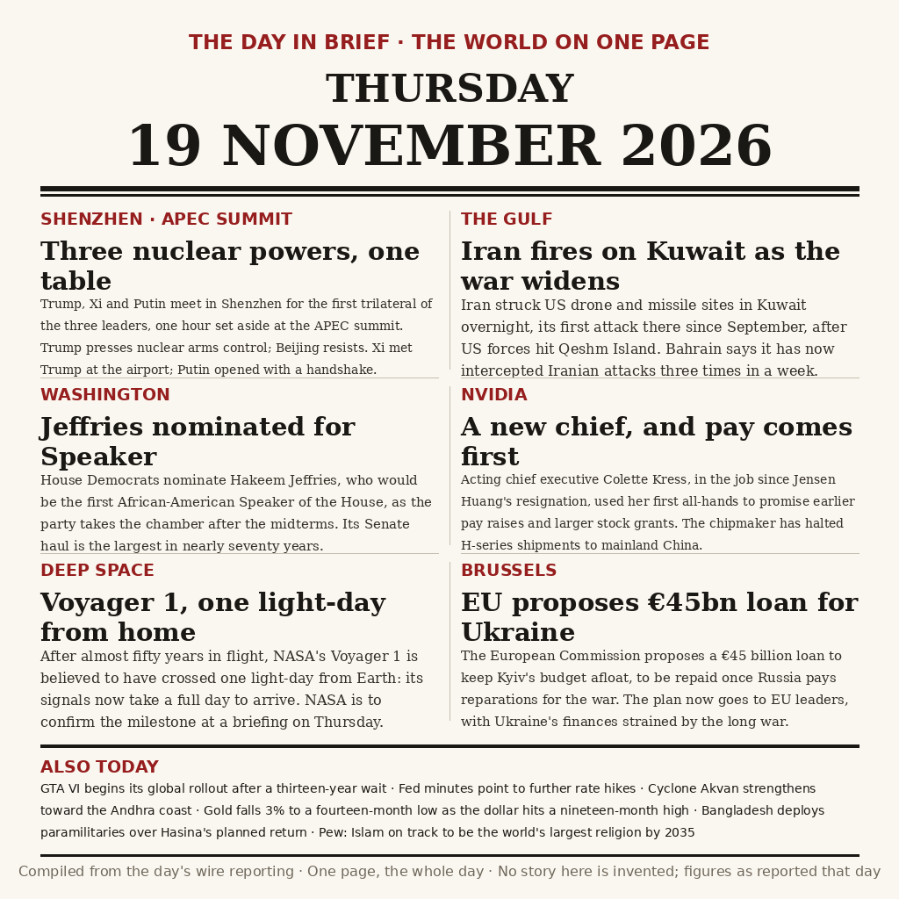

# The Day in Brief — Thursday 19 November 2026

[](https://make.fun/bounty/news-image-20261119?utm_source=github&utm_medium=readme&utm_campaign=news-image-20261119)
[](https://make.fun/bounty/news-image-20261119/leaderboard?utm_source=github&utm_medium=readme&utm_campaign=news-image-20261119)
[](https://make.fun/bounty/news-image-20261119?utm_source=github&utm_medium=readme&utm_campaign=news-image-20261119)

One page, the whole day: a broadsheet front page that sums up the world
news of **Thursday 19 November 2026** in a single 1024×1024 image.



## The front page

- **Shenzhen · APEC summit** — Trump, Xi and Putin hold the first
  trilateral meeting of the three leaders; one hour at the APEC summit,
  nuclear arms control on Trump's agenda, Beijing resisting.
- **The Gulf** — Iran fires on US drone and missile sites in Kuwait for
  the first time since September, after the US strike on Qeshm Island;
  Bahrain intercepts Iranian attacks for the third time in a week.
- **Washington** — House Democrats nominate Hakeem Jeffries, who would
  be the first African-American Speaker of the House.
- **Nvidia** — acting chief executive Colette Kress opens with earlier
  pay raises and larger stock grants; H-series shipments to mainland
  China are halted.
- **Deep space** — Voyager 1 crosses one light-day from Earth after
  almost fifty years in flight; NASA confirms on Thursday.
- **Brussels** — the Commission proposes a €45 billion loan for Ukraine,
  repayable once Russia pays reparations.

The *Also today* strip carries GTA VI's global rollout, the Fed minutes,
Cyclone Akvan, gold's slide to a fourteen-month low, Bangladesh's
paramilitary deployment, and Pew's projection for the world's largest
religion by 2035. Every story comes from the day's wire reporting; no
story is invented, and figures are as reported that day.

## Run it

```sh
python3 main.py            # writes /output/entry.png
MAKEFUN_OUTPUT_DIR=/tmp/out python3 main.py
```

`main.py` is standard library only and needs no network: it delivers the
committed `entry.png` to the output directory and verifies the copy byte
for byte before reporting success.

## Rebuild the page

```sh
python3 tools/render.py 2026-11-19 entry.png
```

The typesetter (`tools/render.py`, Pillow + DejaVu fonts) is
deterministic: the same edition renders byte-identically on every run.
Its `CONTENT` table is the whole editorial input — masthead, six story
panels, the also-today strip and the colophon.

## Licence

MIT — see `LICENSE`.
